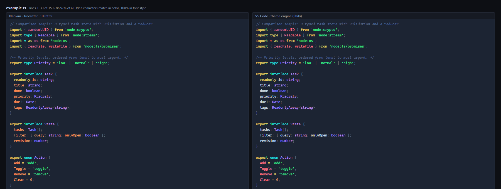
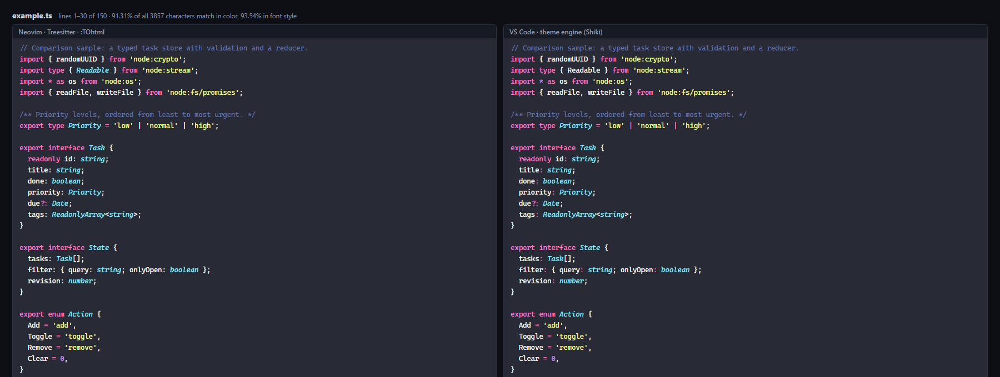
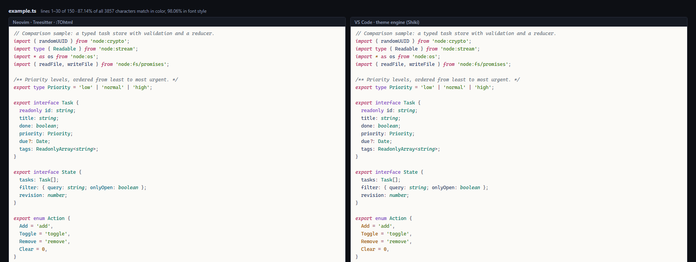
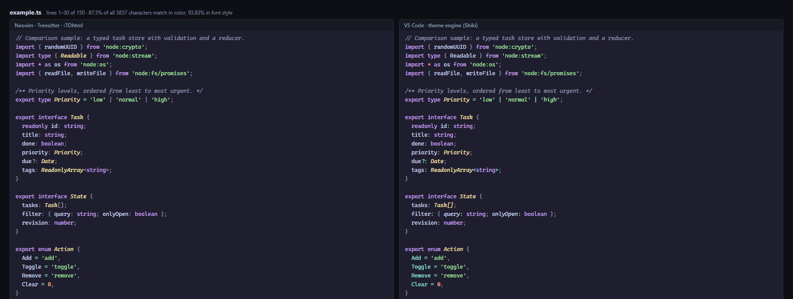

# woodfish.nvim

Woodfish colorschemes for Neovim: 15 themes whose syntax colors and font styles are **measured from how VS Code paints the same code**, so a file looks the same in both editors.

[English](#english) · [中文](#中文)

## English

Left: Neovim with Treesitter. Right: the same code in VS Code's theme engine.






### Why it looks like VS Code

A Treesitter capture is much coarser than a TextMate scope, so mapping one onto the other by hand always drifts. These colorschemes are generated instead:

- VS Code's own theme engine (vscode-textmate) colors 100+ lines of everyday code in each language.
- Neovim's Treesitter says which capture each character gets.
- The majority color and the majority font style (bold, italic, underline, strikethrough) of every "capture + language" pair become the highlight group `@capture.language`.

The result was checked against separate samples that were never used for the statistics. For the ten measured languages (TypeScript, JavaScript, JSX, TSX, Python, Lua, Go, Rust, JSON, Markdown) 80–93% of the characters get the same color as in VS Code depending on the theme, 89.5% on average (the first seven languages 81–94%, 90.6%; JavaScript, JSX and TSX 74–92%, 86.1%); no combination is painted in a color other than the majority one. What is left are captures that VS Code itself paints in several colors, such as JSON keys by nesting depth, which no single highlight group can reproduce. JSX files are parsed by Neovim's `javascript` parser, so JavaScript and JSX share their highlight groups; TSX has its own.

It also stays out of your way: Woodfish defines only language-suffixed groups. It adds no Treesitter queries and no autocommands, so switching to another colorscheme leaves nothing behind.

### Themes

| Colorscheme | |
|---|---|
| `woodfish-dark` | Woodfish Dark |
| `woodfish-dracula` | Woodfish Dracula |
| `woodfish-light` | Woodfish Light |
| `woodfish-black` | Woodfish Black |
| `woodfish-neon` | Woodfish Neon |
| `woodfish-onedark` | Woodfish One Dark Pro |
| `woodfish-tokyonight` | Woodfish Tokyo Night |
| `woodfish-catppuccin-mocha`, `woodfish-catppuccin-latte` | Woodfish Catppuccin Mocha / Latte |
| `woodfish-nord` | Woodfish Nord |
| `woodfish-github-dark`, `woodfish-github-light` | Woodfish GitHub Dark / Light |
| `woodfish-nightowl` | Woodfish Night Owl |
| `woodfish-ayu-mirage` | Woodfish Ayu Mirage |
| `woodfish-gruvbox-dark` | Woodfish Gruvbox Dark |

### Install

Verified on Neovim 0.12; the highlight group names (`@capture`, `@lsp.type.*`) are the ones Neovim has used since 0.9. Use a truecolor terminal with `termguicolors` on (the default in recent Neovim when the terminal supports it).

[lazy.nvim](https://github.com/folke/lazy.nvim)

```lua
{
  "woodfishhhh/woodfish.nvim",
  lazy = false,
  priority = 1000,
  config = function()
    vim.cmd.colorscheme("woodfish-dark")
  end,
}
```

[packer.nvim](https://github.com/wbthomason/packer.nvim)

```lua
use({ "woodfishhhh/woodfish.nvim" })
vim.cmd.colorscheme("woodfish-dark")
```

[vim-plug](https://github.com/junegunn/vim-plug)

```vim
Plug 'woodfishhhh/woodfish.nvim'
call plug#end()
colorscheme woodfish-dark
```

### Options

One option, and `setup()` is optional. Call it before or after `:colorscheme`; every Woodfish colorscheme loaded afterwards keeps it.

```lua
require("woodfish").setup({ transparent = true }) -- no background, the terminal's shows through
```

lualine: `require("lualine").setup({ options = { theme = "woodfish" } })`

### What is covered

Core highlight groups, Treesitter, LSP semantic tokens, diagnostics, diff and git, the 16 terminal colors, and telescope, nvim-cmp, blink.cmp, gitsigns, neo-tree, nvim-tree, which-key, indent-blankline and lualine.

### Relationship with the main repository

The files here are generated from [Woodfish-Theme](https://github.com/woodfishhhh/Woodfish-Theme) (`apps/neovim`), the same palettes and theme files as the VS Code extension, and replaced wholesale on every update. Please do not edit `colors/` or `lua/` by hand; report problems and send changes to the main repository. Method and measurements: [docs/hosts/neovim.md](https://github.com/woodfishhhh/Woodfish-Theme/blob/feat/monorepo-theme-core/docs/hosts/neovim.md).

### License

MIT, see [LICENSE](LICENSE). The palettes of themes that come from other projects keep those projects' licenses, listed in [THIRD_PARTY_NOTICES.md](THIRD_PARTY_NOTICES.md) with the license texts in [licenses/](licenses/). In particular Woodfish Dark comes from a GPL-3.0-only theme: a distribution that includes that palette has to comply with GPL-3.0.

## 中文

15 套 Neovim 配色。语法颜色和字体样式是**按 VS Code 实际给同一份代码的颜色量出来的**，同一个文件在两个编辑器里看起来一致。

**为什么像 VS Code**：Treesitter 的捕获组比 TextMate 的 scope 粗得多，手写对应表总会走样。这里改成生成：用 VS Code 自己的主题引擎给每种语言 100 行以上的常见代码上色，用 Neovim 的 Treesitter 找出每个字符属于哪个捕获组，每个“捕获组 + 语言”取占多数的颜色和字体样式（粗体、斜体、下划线、删除线），写成 `@capture.language`。用没参与统计的另一批样例检查：10 种语言（TypeScript、JavaScript、JSX、TSX、Python、Lua、Go、Rust、JSON、Markdown）按主题 80%–93% 的字符与 VS Code 同色，平均 89.5%（前 7 种 81%–94%，平均 90.6%；JavaScript、JSX、TSX 74%–92%，平均 86.1%）；没有任何组合被画成非多数的颜色。剩下的是 VS Code 自己就给同一个捕获组好几种颜色的地方（比如 JSON 键按嵌套深度换色），一个高亮组对不上。Neovim 用 `javascript` 解析器解析 JSX 文件，所以 JavaScript 和 JSX 共用一套高亮组；TSX 单独一套。

Woodfish 只定义带语言后缀的高亮组，不加 Treesitter query，也不建自动命令，换成别的配色后不留任何痕迹。

**安装**：在 Neovim 0.12 上验证过。上面的 lazy.nvim、packer.nvim、vim-plug 写法直接可用，然后 `:colorscheme woodfish-dark`（15 个名字见上表）。需要真彩色终端并开启 `termguicolors`。

**选项**：只有一个，`setup()` 可选：`require("woodfish").setup({ transparent = true })` 不画背景，透出终端背景；写在 `:colorscheme` 前后都行。lualine：`options = { theme = "woodfish" }`。

**和主仓库的关系**：这里的文件由 [Woodfish-Theme](https://github.com/woodfishhhh/Woodfish-Theme) 的 `apps/neovim` 生成，每次整体替换，请不要手改 `colors/` 和 `lua/`；问题和修改请提到主仓库。

**许可**：MIT。来自其他项目的主题保留各自的许可，见 [THIRD_PARTY_NOTICES.md](THIRD_PARTY_NOTICES.md) 和 [licenses/](licenses/)；其中 Woodfish Dark 来自 GPL-3.0-only 的主题，包含这套配色的分发需要遵守 GPL-3.0。
